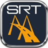
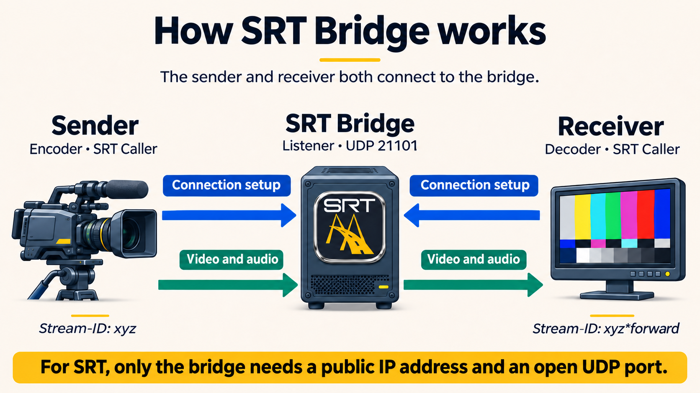

#  SRT Bridge

## What SRT Bridge does

Have you always wanted to send video signals to your studio, to other production locations or to your client with (almost) no additional infrastructure? To do that, you almost always needed either a LiveU or some other service that costs money.

SRT Bridge is a meeting point on the internet for SRT signals. The encoder at the venue and the decoder in the studio both **call** the bridge; neither of them needs an open port or a fixed address. On the transmitter and/or receiver side, it also works with any mobile phone Internet connection, as long as it has the necessary bandwidth. Only the PC with the bridge needs a public IP and one open UDP AND TCP port. The Bridge can be fully controlled remotely via the Internet.

Install this Bridge in your studio on a mid-range computer (Windows 10/11) with an Intel Core i7-6700. Of course, a newer computer will work as well. With this setup, you can easily transmit 8 video signals and optional output 4 of them locally as OMT. If you want to output more signals from the bridge computer, you’ll need a more modern machine: recommended; Intel Core Ultra 200S series desktop CPUs (Arrow Lake) with at least six performance cores and integrated Intel Graphics with hardware AV1 encoding support can be used. Suitable models include the Intel Core Ultra 5 245K, Intel Core Ultra 7 265K, and Intel Core Ultra 9 285K.

The bridge passes the packets on unchanged. Nothing is decoded or encoded again, so the picture quality stays as it was sent and the delay is only the SRT latency on each leg.

## Getting started on Windows

1. Download the Windows installer from the [latest release](https://github.com/peteraellig/srt-bridge/releases/latest), run it and open **SRT Bridge**.
2. In **Setup**, check the SRT port (default **21101**). Allow inbound UDP traffic on that port. If the bridge PC is behind a router, forward the same UDP port to the PC.
3. Set the encoder to **Caller** and enter the bridge’s public address, port and sender stream ID. Once connected, its tile on **Main** shows **LIVE**.
4. Click **Links** on the tile and copy the forward receiver URL to the decoder. Set the decoder to **Caller**. Use **Matrix** to choose which input it receives.

The installer includes **SRT Bridge Output** for local OMT, NDI or SDI output. Configure it in **Outputs**. The **Help** tab explains stream IDs, routing and remote access.

## Building from source

Run these PowerShell commands from the repository root on Windows x64.

| Component | Command | Requirements |
| --- | --- | --- |
| SRT Bridge | `.\srt_bridge\build.ps1` | Go 1.27.2 or compatible |
| SRT Bridge Output | `.\srt_bridge_output\build.ps1` | Go, Visual Studio 18 Community with the x64 C++ tools, Blackmagic Desktop Video |
| Combined installer | `.\srt_bridge\installer\build-setup.ps1` | Requirements for both components, plus Inno Setup 6 or 7 |

The installer script builds both components and writes the setup executable and its SHA-256 checksum to `srt_bridge/dist/`.

## License

SRT Bridge and SRT Bridge Output are licensed under the [BSD Zero Clause License (0BSD)](LICENSE). Copyright © 2026 Peter Aellig.

Bundled third-party components retain their own licenses. See the [Fraunhofer FDK AAC license](srt_bridge_output/engine/third_party/fdk-aac/NOTICE) and the [OMT MIT license](srt_bridge_output/engine/third_party/omt/LICENSE.txt).

Written by Peter Aellig and Claude Fable 5.2 (Anthropic).
